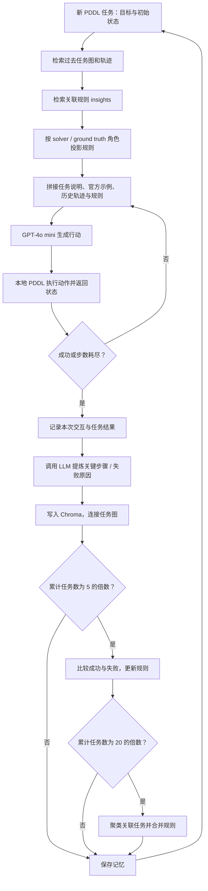

# 论文里的 G-Memory，在代码里分别是什么？

论文：[G-Memory: Tracing Hierarchical Memory for Multi-Agent Systems](https://arxiv.org/abs/2506.07398)。官方实现：[bingreeky/GMemory](https://github.com/bingreeky/GMemory)。本次固定上游 commit `7b581c51d993bd600df14691d101d7e601040cc6`。

## 先看完整流程

其中，模型调用发生在行动生成、关键步骤提炼、失败分析、检索结果打分、规则更新/合并和角色投影。环境执行、存储、图连接和向量编码都在本地完成。

## 三层记忆与源码对应

| 论文概念 | 主要代码 | 保存的内容 | 在下一题中的作用 |
|---|---|---|---|
| Interaction graph / 交互层 | `mas/memory/common.py` 的 `StateChain`、`AgentMessage`、`MASMessage` | 谁提出了动作、提示词是什么、环境返回什么、奖励是多少 | 为一条任务经验提供可追溯的行动过程 |
| Query graph / 任务层 | `mas/memory/mas_memory/GMemory.py` 的 `TaskLayer` | 以任务目标为节点、相似任务间连边 | 从相似任务出发做 hop 扩展，找到可借鉴的旧经历 |
| Insight 层 | 同文件的 `InsightsManager` | 规则文本、得分、关联任务 | 将多次经验提炼成可重复利用的建议 |

这三层不是三台模型，也不是三个独立 API。一次运行中，它们与 agent 共用同一个模型适配器。

在当前实现里，任务层是实际的 NetworkX 图；insight 层主要通过“规则列表 + 关联任务字段”表达连接关系；交互层则把各步 agent 消息图串成状态链。论文的三层图概念，在存储时并不是三个完全相同格式的图文件。

## 论文的 PDDL 指标究竟是什么？

[论文附录 A.1](https://arxiv.org/html/2506.07398v2#A1) 明确把 PDDL 的主指标写为 **progress rate（进度率）**，不是整题成功率。本次同时保存两者：平均 `reward` 用来观察目标完成进度，`success=true` 的比例用来观察是否完整解决任务。不能把论文表里的 PDDL 数字与我们的整题成功率直接相减。

上游环境的 `reward` 是执行过程中达到过的最大子目标满足比例，范围 0–1；报告会乘 100 显示为百分数。只有 `done`/`success` 表示所有目标满足。不同题目、步数、服务线路和记忆积累顺序仍会影响比较，因此即使指标名称一致，也不能据此宣称复现了论文数值。

任务图的节点键是 `task_main` 目标文本，不是唯一的 episode 编号。因此，不同初始状态若恰好拥有同一个目标，可能对应同一个图节点，而 Chroma 中仍有多条任务记录。“图节点数”和“已存任务数”不一定相等。

这次有一个实际例子：主实验 `task_id=15` 与 `16`（barman 的第 4、5 题）目标都要求 `shot1 contains cocktail1`，但任务描述/初始观察文本不同。它们共用目标节点，数据库仍保留各自的轨迹。这个存储事实已经核实；是否影响选择适用经验，还需要另外做实验。

## 一题怎么走完？

1. `PDDLEnv.set_env()` 选择真实领域文件和 problem 文件；`reset()` 得到当前状态。这里的状态由 PDDL 引擎维护。
2. `AutoGen.schedule()` 初始化当前任务上下文，然后调用 `meta_memory.retrieve_memory()`。
3. GMemory 先从任务图和 Chroma 检索成功/失败经验，再让 LLM 给成功经验的相关性打分，保留指定条数。我们的配置最终提供 1 条成功经验、最多 3 条规则。
4. 开启 projector 后，对 solver 和 ground truth 两个角色分别调用模型，得到角色化建议。
5. `format_task_prompt_with_insights()` 把官方 few-shot、旧任务轨迹、规则和当前任务历史拼进提示词。
6. solver 用模型生成一个动作；PDDL 本地解析并执行。失败动作会有负的 step reward，最终成功与否来自环境反馈。
7. 若同一个动作连续重复，代码会调用 ground truth agent 提议替代动作。这个名字不代表它拥有当前题的真实答案；它仍然使用同一个 LLM，只是角色提示不同。
8. 每一步保存 agent 消息、动作、观察和奖励。任务完成或步数用尽后，保存跨任务记忆，再更新已使用规则的分数。

这里的 AutoGen 是官方仓库自带的 `tasks/mas_workflow/autogen/autogen.py` 工作流，不是直接运行微软 AutoGen 框架的现成团队。

本次 AutoGen 通常每个环境步骤只有一个实际行动节点；没有覆盖 MacNet 等工作流中更复杂的通信拓扑。复现了这条 AutoGen 路径，不代表已经验证所有 MAS 结构。

还有一个容易忽略的边界：检索时的 `query_task` 是当前目标文本。当前初始状态会进入最终 agent 提示词，但没有作为完整状态直接传入这次任务检索。检索到旧轨迹后，模型仍需判断其中哪些步骤适用于新的初始条件。

核对完整 API 输入时，以 `calls.jsonl` 的 `messages` 为准。`Agent.response()` 实际发送的 system 文本包含角色基础说明和当前领域的动作说明；上游 AutoGen 写入状态链的 `system_instruction` 字段只取基础角色说明，状态链的 `user_instruction` 则保存实际 user 文本。因此，只读状态链的 system 字段会漏掉当前领域说明。

## W、P、R 在哪里？

- **写入 / W**：`MASMemoryBase.save_task_context()` → `GMemory.add_memory()`。当前题结束后，才把本题加入长期记忆。
- **处理 / P**：`_extract_mas_message()` 提炼关键步骤；失败时 `_detect_mistakes()` 分析原因；`finetune_insights()` 更新文本规则；`merge_insights()` 合并规则。
- **检索 / R**：`retrieve_memory()` → `_retrieve_memory_raw()`、任务图扩展、向量搜索、LLM 相关性评分与规则查询。

`finetune_insights` 这个函数名容易误解：它通过提示词让模型增删改规则文本，不训练或更新 GPT-4o mini 的权重。

规则反馈也采用明确的代码规则：`GMemory.backward()` 在整题成功时给被使用的规则加 1 分，失败时扣 2 分，分数不大于 0 的规则被删除。这个分数不是概率或已验证的置信度；整题结果无法直接说明每条规则各自贡献了多少，仍需要单独的对照或消融来判断。

此外，`InsightsManager._update_rules()` 中的 `AGREE`、`EDIT` 操作也会加分；`REMOVE` 会扣分，`ADD` 初始为 2 分。因此较高分数还可能来自规则更新阶段的模型评价，不等于已经成功使用过同样次数。

## 记忆究竟放在哪里？

每组实验有独立的 `runs/<组名>/memory/<namespace>/`：

- Chroma：保存任务文本、向量和 metadata，落地为 SQLite 及向量索引文件。
- `task_layer_graph.pkl`：NetworkX 任务图的 pickle 文件。
- `insights.json`：规则及其分数、关联任务。
- `insights.log`：规则提炼/合并的日志。

所以“记忆是不是 JSON”要分层回答：有些规则直接是 JSON；交互图被序列化成字符串放进 metadata；检索数据库还保存向量和索引。程序重新启动时，从同一目录重新构建对象，才能继续读取这些内容。模型本身不会自动记住我们上一轮 API 请求。

## 本次与原版的明确差异

| 调整 | 原因 | 对理解结果的影响 |
|---|---|---|
| 移除打印 Key | 原版导入 `mas.llm` 会输出完整凭据 | 无算法影响 |
| 按需加载环境 | 跑 PDDL 不应强制安装其他基准 | 本次只验证 PDDL 路径 |
| reset 清空旧观察缓存 | barman/tyreworld 二次 reset 会得到空初始观察 | 修复环境呈现错误，因此不是逐字不改的原版执行 |
| Chroma 1.0.9 + 适配器 0.2.4 | Windows 下旧依赖需要额外编译工具 | 依赖差异已记录，检索/存储已做真实回归检查 |
| FINCH 改用函数 API 的第一层划分 | 原调用与固定依赖接口不符，会在合并时崩溃 | 第一层即最细划分是明确实现选择，原错误代码未给出可运行的划分结果 |
| 独立有界运行入口 | 原 `max_trials` 不限制题目数，费用公式写死 | 显式限制题目、token 和总额度，并保留全过程 |
| 主实验 24 题、每题 30 步 | 30 步与官方 README 的 PDDL 示例一致；CLI 省略参数时默认 50 | 任务子集不等同于论文全量；90 步补充诊断另行报告 |
| ChatAnywhere GPT-4o mini | 用户提供的模型服务 | 保留 backbone 名称，服务线路与论文直连 OpenAI 不同 |

具体运行证据和未修复的上游行为见 `REPORT_zh.md`；不要仅凭代码名字推断某条机制已经正确生效。
